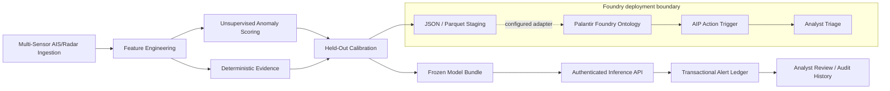
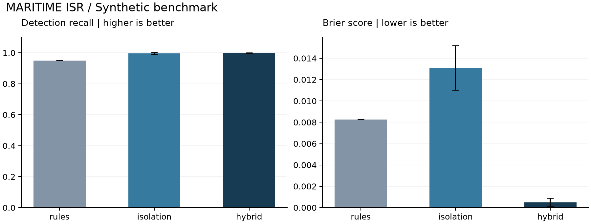

# Maritime ISR

[Portfolio: melgoldstein.com](https://melgoldstein.com/)

### Multi-sensor anomaly detection and Ontology-driven triage

[](https://github.com/melgoldstein/isr-maritime-threat-ml/actions/workflows/quality.yml)

A reproducible Python engineering study of maritime track anomalies: fuse simulated
AIS and radar observations off Port Canaveral, Florida (reference 28.4158 N, 80.6048 W).
The simulation covers a synthetic offshore sector around 28.4 N, 80.5 W. Derive causal
kinematic evidence, calibrate anomaly scores,
and produce typed records for a Palantir Foundry triage workflow.

**Research question:** can an unsupervised detector recover events missed by explicit
rules without inheriting the detector's false-positive rate?

The implementation compares rules, IsolationForest, and a calibrated hybrid on independent
synthetic cohorts. It includes executable tests, recorded benchmark results, explicit
serialization contracts, and a documented boundary between local inference and Foundry.
The repository includes local inference, reproducible evaluation and Foundry integration contracts.

**Version 0.2 adds a runnable service:** frozen model bundles, authenticated inference,
transactional replay, analyst review history, and a non-root Docker deployment.
Every scored observation includes its feature evidence. Run the pipeline, serve the bundle,
and exercise the flow through the generated OpenAPI interface.

[Results](reports/BENCHMARK.md) · [Model card](docs/MODEL_CARD.md) ·
[Engineering](docs/ENGINEERING.md) · [Foundry integration](docs/FOUNDRY.md) ·
[Review guide](docs/REVIEW_GUIDE.md)

[Run the service](docs/SERVING.md) · [Stress evaluation](reports/stress/STRESS.md) ·
[Version 0.2 changes](docs/RELEASE_0_2.md)

## Architecture



The local pipeline ends at staging. No credentials or live Foundry actions are required.

## Results

Five independent evaluation seeds, **21,600 observations per method**, with disjoint
reference and calibration cohorts. All three methods receive isotonic calibration.
The alert threshold is fixed at 0.65 before evaluation.

| Method | Precision | Recall | Brier score |
| :--- | ---: | ---: | ---: |
| Rules only | 1.0000 | 0.9500 | 0.0083 |
| IsolationForest only | 0.9190 | 0.9967 | 0.0131 |
| Hybrid | **0.9992** | **0.9981** | **0.0005** |



Values are means; error bars show sample standard deviation across seeds, not confidence
intervals. Full dispersion, confusion counts, and calibration bins are in
[the benchmark report](reports/BENCHMARK.md). The simulator's injected events align with
the rules, making this a controlled engineering experiment. These results do not establish
field performance or a probability of hostile intent.

### Frozen-model challenges

The same detector is tested on unseen scenario constructions without refitting:
AIS outages, degraded radar, benign RCS changes, legitimate fishing without AIS, and
gradual position drift. The [stress report](reports/stress/STRESS.md) records false-alert
episodes per vessel-hour, event recall and detection delay at three thresholds.
At the default threshold, gradual drift has a **46-minute median detection delay**;
degraded radar produces **12.370 false episodes per benign vessel-hour**. These failures
are retained as measurable deployment limitations.

## Reproduce

Python 3.11 or 3.12. Run from the repository root.

```bash
git clone https://github.com/melgoldstein/isr-maritime-threat-ml.git
cd isr-maritime-threat-ml
python3.11 -m venv .venv
.venv/bin/python -m pip install -r requirements.txt
.venv/bin/python -m src.pipeline --seed 42 --threshold 0.65
.venv/bin/python -m pytest --cov=src --cov-report=term-missing
.venv/bin/python -m src.evaluate --output reports
```

Windows PowerShell:

```powershell
git clone https://github.com/melgoldstein/isr-maritime-threat-ml.git
cd isr-maritime-threat-ml
py -3.11 -m venv .venv
.\.venv\Scripts\python.exe -m pip install -r requirements.txt
.\.venv\Scripts\python.exe -m src.pipeline --seed 42 --threshold 0.65
.\.venv\Scripts\python.exe -m pytest --cov=src --cov-report=term-missing
.\.venv\Scripts\python.exe -m src.evaluate --output reports
```

The installed `isr-maritime` command has the same pipeline interface. `--tracks` selects
the **generated** CSV destination; `--output` selects the artifact directory. The CLI
regenerates synthetic observations rather than reading an existing sensor file.
For the recorded Python 3.12 environment, install `requirements-lock.txt` followed by
`pip install --no-deps -e .`. Other environments resolve the declared dependency ranges.

## What to inspect

| Component | Engineering focus |
| :--- | :--- |
| [Simulator](src/ingest/ais_simulator.py) | Seeded trajectories, explicit scenario truth, nullable AIS |
| [Kinematics](src/features/kinematics.py) | Great-circle distance, circular bearings, causal windows, sensor validation |
| [Detector](src/models/isolation_detector.py) | Reference-percentile scoring, deterministic evidence, separate calibration |
| [Ontology mapper](src/palantir/ontology_mapper.py) | Typed envelopes, explicit Arrow schema, stable event identity |
| [Evaluation](src/evaluate.py) | Independently calibrated ablations, cohort isolation, reproducible figures |
| [Model artifacts](src/models/artifact.py) | Frozen estimator, content identity and runtime compatibility |
| [Inference service](src/service/api.py) | Validated requests, authentication and observation-level evidence |
| [Alert ledger](src/service/store.py) | Atomic replay, concurrent deduplication and review history |
| [Stress suite](src/stress.py) | Frozen-model failures, alert burden and event-level latency |
| [Tests](tests) | Geometry, time gaps, label exclusion, replay, empty exports and benchmark accounting |

## Output contract

The default run creates `artifacts/scored_tracks.parquet`, `maritime_vessels.parquet`,
`ontology_payload.json`, `metrics.json`, and `run_manifest.json`. The manifest records
input SHA-256, seeds, feature order, installed dependencies, and calibration knots.
The committed sensor fixture contains 48 contacts sampled once per minute for 90 minutes.

An exported vessel object has this shape; values below are illustrative:

```json
{
  "vesselId": "S7-42-0001",
  "mmsi": null,
  "lastObserved": "2026-01-01T01:29:00+00:00",
  "latitude": 28.4,
  "longitude": -80.5,
  "threatScore": 0.99,
  "reasonCodes": ["DARK_LOITERING"]
}
```

Each flagged contact receives an `IsrThreatAlertAction` proposal with a deterministic
alert ID and `PENDING_REVIEW` status. See the [complete envelope and mapping](docs/FOUNDRY.md)
and the [generated sample](examples/ontology_payload.json).

## Scope and limitations

- Only synthetic observations are used. Vessel identity association is assumed correct.
- RCS baselines are illustrative dBsm values; weather, aspect and sensor frequency are omitted.
- Scenario labels supervise calibration only; the IsolationForest fit remains unsupervised.
- Correlated observations within a vessel are not independent statistical samples.
- A real deployment needs field labels, sensor-health handling, drift monitoring, persistent
  infrastructure, deployment-specific permissions, and reviewed external action execution.

The [model card](docs/MODEL_CARD.md) explains the evaluation protocol and failure modes.
The [contribution guide](CONTRIBUTING.md) defines local checks and review expectations.
