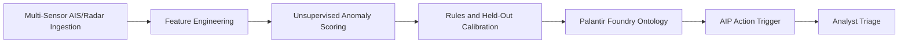

# Maritime ISR | Threat Analytics

Multi-sensor maritime anomaly detection with typed Foundry Ontology staging and an
auditable AIP triage contract. Python 3.11+. All observations are synthetic; no live
sensor feeds, credentials, vessel intelligence, or Foundry connection are included.



## Run

From the repository root on Windows PowerShell:

```powershell
py -3.11 -m venv .venv
.\.venv\Scripts\python.exe -m pip install -r requirements.txt
.\.venv\Scripts\python.exe -m src.pipeline --seed 42 --threshold 0.65
.\.venv\Scripts\python.exe -m pytest -q
.\.venv\Scripts\python.exe -m ruff check src tests
```

On Linux or macOS:

```bash
python3.11 -m venv .venv
.venv/bin/python -m pip install -r requirements.txt
.venv/bin/python -m src.pipeline --seed 42 --threshold 0.65
.venv/bin/python -m pytest -q
.venv/bin/python -m ruff check src tests
```

The installed `isr-maritime` command provides the same interface. Override `--tracks`
and `--output` to choose the generated CSV destination and artifact directory.
The pipeline regenerates the synthetic CSV; it does not ingest an existing CSV.

## Engineering layout

| Module | Responsibility |
| --- | --- |
| `src/ingest/ais_simulator.py` | Seeded one-minute radar/AIS observations and scenario truth |
| `src/features/kinematics.py` | Causal per-contact distance, velocity, turn rate, sensor disagreement and RCS evidence |
| `src/models/isolation_detector.py` | IsolationForest, rule evidence and isotonic calibration |
| `src/palantir/ontology_mapper.py` | Typed JSON action envelopes and explicit Arrow object schema |
| `src/pipeline.py` | Independent scenario cohorts, evaluation and lineage manifest |
| `tests/test_pipeline.py` | Geometry, causality, invalid inputs, leakage and serialization contracts |

## Sensor and scoring contract

The committed `data/sector_7_tracks.csv` contains 48 contacts and 90 observations per
contact. Cargo, tanker and fishing tracks follow noisy cruise trajectories. Injected
events include a persistent AIS position offset, radar-only slow circular movement,
and a radar signature inconsistent with the declared vessel class. Synthetic MMSIs
are identifiers for this fixture only. Radar association supplies the stable contact
ID even when AIS disappears; association uncertainty is outside this simulator.

Coordinates use WGS84 latitude/longitude with a spherical great-circle approximation.
Distance is metres, speed is knots, turn rate is degrees/minute, timestamps are UTC.
RCS uses **dBsm**, not dBm: cross-section and received radar power are different quantities.
The class-dependent RCS baselines are illustrative and omit aspect, frequency and sea state.

Feature windows are causal and isolated by track. Duplicate timestamps and invalid
coordinates fail validation. Missing AIS remains explicit in the sensor log; derived
unavailable residuals use zero while AIS absence accumulates separately. First-observation
motion features use zero and `history_ready=false`. Radar turn rate uses circular angle
differences. Loitering requires ten observations with mean speed below 3 knots and mean
turn rate above 8 degrees/minute; dark loitering also requires ten minutes of AIS absence.

IsolationForest fits the seed-43 reference cohort. Its anomaly magnitude becomes an
empirical reference percentile, scaled to 0.8. Deterministic evidence supplies a floor
of 0.85 for speed disagreement above 12 knots, AIS/radar separation above 500 metres,
dark loitering, or an RCS residual above 10 dB. Isotonic regression calibrates this
combined evidence using the independent seed-44 labeled cohort. Seed 42 is evaluation
only. Scenario labels never enter the feature matrix or scoring path.

`threat_score` is a calibrated synthetic anomaly likelihood in [0, 1]. It is not an
operational probability of hostile intent. Cohorts have disjoint contact IDs but share
a simulator; field validation must account for sensor quality, traffic prevalence,
geography and previously unseen behaviors. Threshold selection requires operational
costs and analyst review. Live deployment would also require track association,
sensor-health gates, model persistence, drift monitoring and calibrated field labels.

## Artifacts and lineage

| Output | Contract |
| --- | --- |
| `artifacts/scored_tracks.parquet` | Full observation history with evidence, scores and scenario truth |
| `artifacts/maritime_vessels.parquet` | One latest flagged observation per contact, explicit nullable MMSI and UTC timestamp |
| `artifacts/ontology_payload.json` | Versioned object snapshots and proposed action parameters |
| `artifacts/metrics.json` | Precision, recall, average precision, Brier score and scenario recall |
| `artifacts/run_manifest.json` | Seeds, dependency versions, CSV SHA-256, feature order and calibration knots |

The flagged snapshot is the last flagged observation, which may precede the latest
observation. It is not a current fleet-state table. Alert IDs are deterministic UUIDs
derived from schema version, contact and observation time. A Foundry receiver must
enforce idempotency; producing the same ID does not itself prevent repeated actions.

## Foundry Ontology and AIP integration

These are staging contracts, not a portable Ontology deployment bundle or raw API
request body. Configure the following in your Foundry enrollment:

1. Ingest `maritime_vessels.parquet` as a backing dataset and create
   `MaritimeVesselObject`. Map `vesselId` to its string primary key, `lastObserved` to
   timestamp, `latitude`, `longitude`, `threatScore` to double, `mmsi` to nullable
   string, and `reasonCodes` to a string array.
2. Create an alert object type keyed by `alertId`, linked to the vessel through
   `vesselId`. Configure `IsrThreatAlertAction` with the parameter names below and
   rules to create/update the alert with `PENDING_REVIEW` status. Resolve actual API
   names and object-reference parameter encodings from the configured Ontology.
3. Have an authenticated integration consume the action envelopes, validate permissions
   and submission criteria, and apply the configured action using its `parameters`.
   Keep enrollment hostname, Ontology identifier and credentials outside the repository.
4. Use AIP Logic to retrieve the linked evidence and propose an analyst summary. Require
   a reviewer for disposition; keep score, reasons, model version and review decisions
   in the audit record. This repository exports proposals and performs no live action.

Foundry object and action definitions are deployment-specific. See the official
[type reference](https://www.palantir.com/docs/foundry/object-link-types/type-reference),
[action overview](https://www.palantir.com/docs/foundry/action-types/overview/), and
[action rules](https://www.palantir.com/docs/foundry/action-types/rules).

Illustrative JSON excerpt; numerical values depend on the run:

```json
{
  "schemaVersion": "1.0.0",
  "objectType": "MaritimeVesselObject",
  "objects": [{
    "vesselId": "S7-42-0001",
    "mmsi": null,
    "lastObserved": "2026-01-01T01:29:00+00:00",
    "latitude": 35.1,
    "longitude": 24.2,
    "threatScore": 0.99,
    "reasonCodes": ["DARK_LOITERING"]
  }],
  "actions": [{
    "actionType": "IsrThreatAlertAction",
    "parameters": {
      "alertId": "6ff65fc1-d475-5bb8-a027-1da30d19f826",
      "vesselId": "S7-42-0001",
      "observedAt": "2026-01-01T01:29:00+00:00",
      "threatScore": 0.99,
      "reasonCodes": ["DARK_LOITERING"],
      "status": "PENDING_REVIEW"
    }
  }]
}
```

## Verification

CI runs formatting, lint, contract tests and the complete pipeline on Python 3.11 and
3.12. Tests assert geodesic behavior across the antimeridian, invariance to input order,
prefix causality, rejection of duplicate observations, exclusion of truth labels,
independent calibration contacts, empty-export schema stability and replay-stable IDs.
Dependency ranges are declared in `pyproject.toml`; `requirements-lock.txt` records the
validated environment for exact-version reinstalls. Generated artifacts are ignored.
